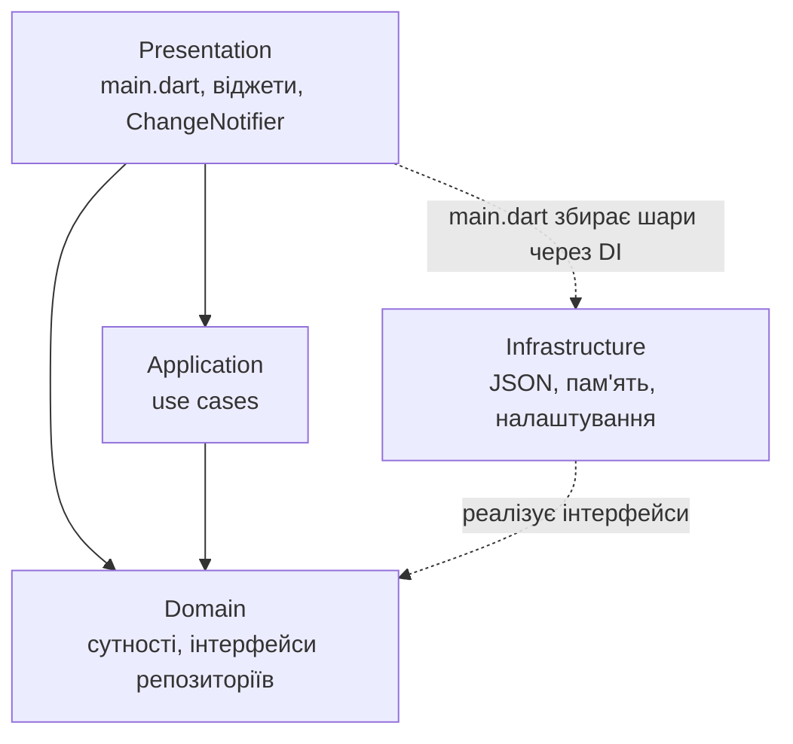

# Погодний застосунок

Навчальний Flutter-застосунок з прогнозом погоди на тиждень. Варіант 6, дисципліна «Сучасні технології проєктування», лабораторна робота №5.

Що вміє застосунок:

- показує погоду на вибраний день і прогноз по годинах;
- перемикає температуру між °C і °F;
- змінює місто через поле пошуку;
- бере прогноз із JSON-файлу або зі сховища в пам'яті, залежно від налаштувань.

## Архітектура

Код поділено на чотири шари за Clean Architecture. Стрілка означає «залежить від»: зовнішні шари знають про внутрішні, а навпаки ні.



| Шар | Папка | Що містить |
|---|---|---|
| Domain | `lib/domain` | сутності, правило перерахунку температури, інтерфейси `WeatherRepository` і `CityRepository` |
| Application | `lib/application` | use cases, які працюють лише через інтерфейси домену |
| Infrastructure | `lib/infrastructure` | `JsonWeatherRepository`, сховища в пам'яті, читання налаштувань |
| Presentation | `lib/presentation`, `lib/main.dart` | екран, віджети, стан на Provider, збирання залежностей |

Domain не імпортує Flutter. Тому стан погоди там описаний переліком `WeatherCondition`, а значки підбирає Presentation. Напрямок залежностей перевіряє тест `test/architecture_test.dart`.

## Структура проєкту

```text
lib/
  main.dart                  точка входу, збирання шарів
  domain/
    entities/                сутності й одиниці температури
    repositories/            інтерфейси сховищ
  application/
    use_cases/               сценарії застосунку
  infrastructure/
    config/                  читання app_settings.json
    repositories/            реалізації сховищ
  presentation/
    mappers/                 значки для станів погоди
    screens/                 головний екран
    state/                   ChangeNotifier
    widgets/                 віджети екрана
assets/
  config/app_settings.json   налаштування
  data/forecast.json         дані прогнозу
```

## Збірка і запуск

Потрібен Flutter SDK з Dart 3.13 або новішим і браузер Chrome.

```bash
flutter pub get
flutter run -d chrome
```

Тести:

```bash
flutter test
```

Вебзбірка з'явиться в `build/web`:

```bash
flutter build web
```

## Налаштування

Файл `assets/config/app_settings.json`:

| Поле | Значення |
|---|---|
| `dataSource` | `json` читає прогноз із файлу, `memory` бере його зі сховища в пам'яті |
| `forecastAsset` | шлях до JSON-файлу прогнозу |
| `defaultUnit` | `celsius` або `fahrenheit` |
| `defaultCity` | місто під час запуску |

Щоб змінити спосіб зберігання, достатньо поміняти `dataSource`. Use cases і екран при цьому не змінюються.

## Гілки

- `main` — стабільний код.
- `develop` — інтеграційна гілка.
- `feature/*` — окрема гілка під кожну задачу.

Назви комітів оформлені за Conventional Commits: `feat`, `fix`, `test`, `docs`, `chore`.
